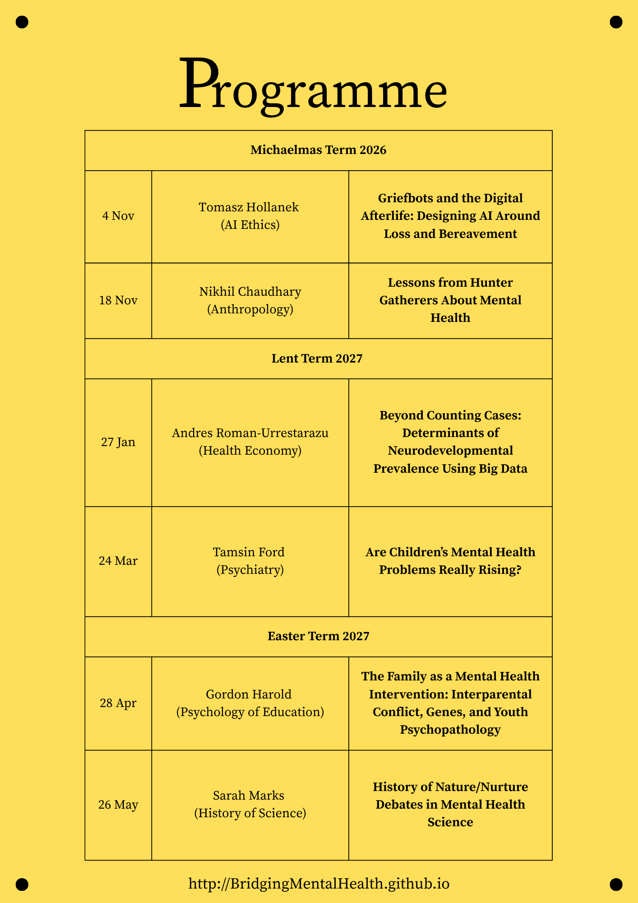

## Academic Year 2026/2027   
This academic year, the network is  launching a series of six interdisciplinary talks. Each term will feature two talks under a broad common theme from speakers bringing different disciplinary perspectives.   

All are welcome!

**Time**   
Wednesdays 5 - 6 PM   

**Location for the First Event on November 4th**
Department of History and Philosophy of Science  
Free School Lane  
Seminar Room 1 (Ground floor, right hand side of the main entrance  

Sign up for the first event [here](https://forms.gle/2PYMxtD8n7SZ8aJy6). 
(Signing up is not mandatory but recommended to guarantee you a seat.)  
   
Location for the later talks to be announced.
   

# Flyer
We welcome distribution of flyers in your departments and colleges around Cambridge.    
[Download Printable Flyer](pictures/Academic Year 202627-2.png)  
<embed src="/assets/flyer.pdf" type="application/pdf" width="100%" height="600px">
